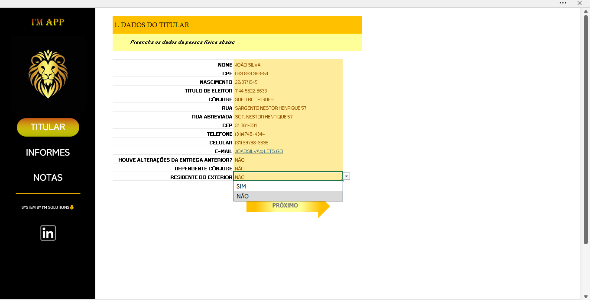
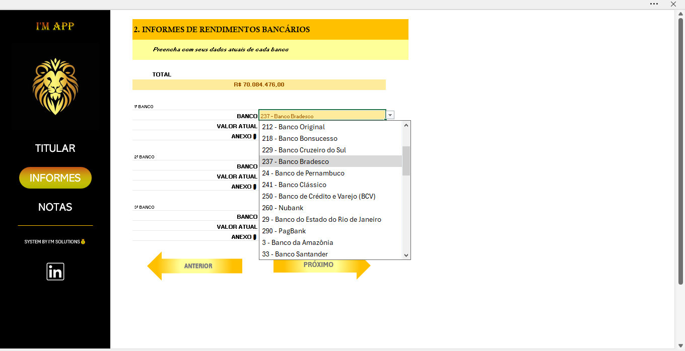
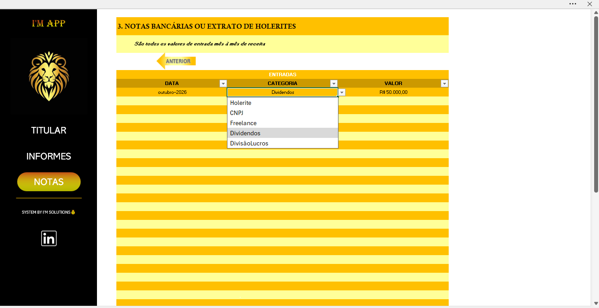

# Organizador de Dados para Declaração de Imposto de Renda

## 📌 Sobre o projeto

Projeto desenvolvido como parte de um desafio prático da **Digital Innovation One (DIO)**, com o objetivo de criar uma ferramenta em Excel para organizar informações relevantes à preparação da declaração de Imposto de Renda.

A solução funciona como um agregador de informações cadastrais, informes de rendimentos bancários e registros de receitas. O arquivo conta com abas organizadas por etapa, campos editáveis, listas suspensas, cálculo automático, navegação por links e proteção de células.

## 🎯 Objetivo

Construir uma ferramenta prática que permita reunir informações em um único arquivo, facilitando sua organização e consulta.

O projeto busca atender às seguintes necessidades:

- Organizar os dados cadastrais do titular;
- Registrar informações e valores de informes bancários;
- Consolidar automaticamente os valores registrados;
- Organizar entradas financeiras por data, categoria e valor;
- Padronizar o preenchimento com validações;
- Reduzir alterações acidentais na estrutura da planilha.

## 🗂️ Estrutura da planilha

O arquivo está dividido em quatro abas.

### 1. Titular

Centraliza os dados cadastrais da pessoa física, incluindo:

- Nome e CPF;
- Data de nascimento;
- Título de eleitor;
- Informações de cônjuge;
- Endereço, CEP e telefone;
- Celular e e-mail;
- Indicadores sobre alterações na entrega anterior, dependência do cônjuge e residência no exterior.

Os campos de resposta SIM/NÃO possuem lista de validação para padronizar o preenchimento.

### 2. Informes

Permite organizar informações de até três instituições bancárias.

Para cada registro, o usuário pode informar:

- Banco;
- Valor atual;
- Nome do documento ou anexo correspondente.

**Seleção de bancos:** os campos de instituição bancária possuem menus suspensos vinculados à lista de bancos cadastrada na aba `Bancos`.

**Totalização automática:** o campo de total utiliza a fórmula:

`=SUM(D12,D17,D22)`

A fórmula soma os valores informados nos três registros bancários. Quando esses valores são alterados, o Excel recalcula o total.

### 3. Notas

Destinada ao registro de entradas financeiras ao longo do tempo.

A tabela possui campos para:

- Data;
- Categoria;
- Valor.

O campo de categoria conta com uma lista suspensa que padroniza as classificações disponíveis, incluindo:

- Holerite;
- CNPJ;
- Freelance;
- Dividendos;
- Divisão de lucros.

Essa organização permite manter os lançamentos em uma estrutura uniforme e facilitar sua consulta posterior.

### 4. Bancos

Contém a lista de instituições utilizada pelos menus suspensos da aba `Informes`.

A aba está oculta na apresentação principal para manter a interface organizada. Ela pode ser reexibida no Excel para consulta ou manutenção da lista.

## 🔐 Proteção de células e planilhas

As abas principais foram protegidas para reduzir o risco de alterações acidentais na estrutura do arquivo.

A configuração diferencia:

- **Células bloqueadas:** destinadas à estrutura, aos títulos e aos elementos que não precisam ser alterados durante o preenchimento normal.
- **Células desbloqueadas:** destinadas à entrada e à atualização das informações pelo usuário.

A proteção foi configurada para permitir o preenchimento dos campos previstos sem liberar indiscriminadamente toda a estrutura da planilha.

### 🔑 Senha para validação pelo avaliador

**Senha de proteção das planilhas: `Dio@2026`**

O professor ou avaliador pode utilizar essa senha para desproteger as abas principais e verificar as fórmulas, os campos editáveis, as validações e a estrutura interna do projeto.

Para testar:

1. Abra o arquivo no Excel.
2. Acesse a aba que deseja verificar.
3. Entre na opção **Revisão → Desproteger Planilha**.
4. Informe a senha `Dio@2026`.
5. Inspecione as fórmulas, os campos e as configurações.
6. Ao concluir, proteja novamente a planilha, se necessário.

A proteção é destinada à integridade operacional e à prevenção de alterações involuntárias. Não constitui mecanismo de criptografia ou garantia de confidencialidade dos dados.

## 🧭 Navegação e apresentação visual

O projeto utiliza elementos gráficos com links internos para facilitar a navegação entre as etapas.

Também há atalhos externos, incluindo links de e-mail e LinkedIn.

Para melhorar a experiência de uso, as abas principais possuem apresentação visual simplificada, com linhas de grade e cabeçalhos de linhas e colunas ocultos.

## 🧪 Dados simulados e editáveis

**Todos os dados pessoais, financeiros e bancários preenchidos no arquivo são simulados e editáveis nos campos destinados à entrada de informações.**

Os nomes, identificadores, contatos, instituições, documentos e valores apresentados servem exclusivamente para demonstrar o funcionamento da ferramenta.

Os dados não devem ser interpretados como informações reais de uma pessoa ou de suas contas bancárias.

Antes de compartilhar qualquer versão preenchida, recomenda-se revisar o conteúdo e confirmar que não há informações reais ou confidenciais.

## 🚀 Recursos e conhecimentos aplicados

Durante o desenvolvimento, foram aplicados conceitos de:

- Organização de dados em múltiplas abas;
- Fórmulas de cálculo e consolidação de valores;
- Validação de dados por listas suspensas;
- Proteção de planilhas e bloqueio seletivo de células;
- Estruturação de tabelas para registros financeiros;
- Navegação por links internos e externos;
- Organização visual de uma interface em Excel;
- Documentação técnica em Markdown;
- Versionamento e compartilhamento de projetos pelo GitHub.

## 🔧 Possíveis evoluções

Como oportunidades futuras de melhoria, o projeto pode receber:

- Validações adicionais para datas, valores e identificadores;
- Expansão da quantidade de instituições e registros;
- Indicadores e resumos visuais das informações;
- Orientações contextuais para cada campo;
- Aprimoramento da organização dos documentos de origem;
- Testes adicionais de consistência e integridade dos dados.

## ⚠️ Limitações e responsabilidade

A planilha é um organizador de informações desenvolvido para fins educacionais. Ela não substitui o programa oficial da Receita Federal, não transmite declarações e não garante a conformidade fiscal dos registros.

Antes de utilizar qualquer informação em uma declaração efetiva, o usuário deve conferir os documentos de origem, os informes oficiais e as orientações vigentes da Receita Federal.

## 👨‍💻 Autor

**Ivan Moyses Ramos**

Projeto desenvolvido como parte de um desafio prático da Digital Innovation One (DIO).

## 📸 Demonstração do projeto

### Dados do titular

### Informes bancários

### Lançamentos financeiros

